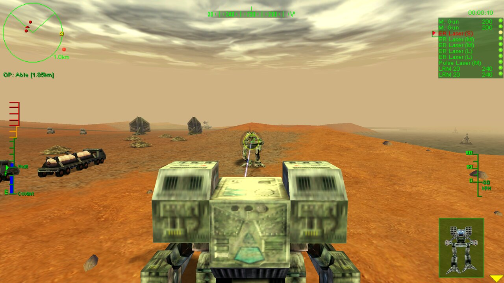
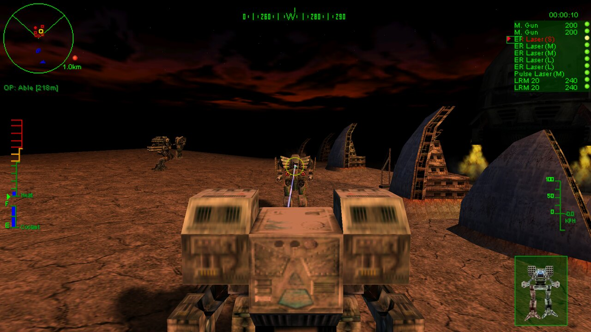
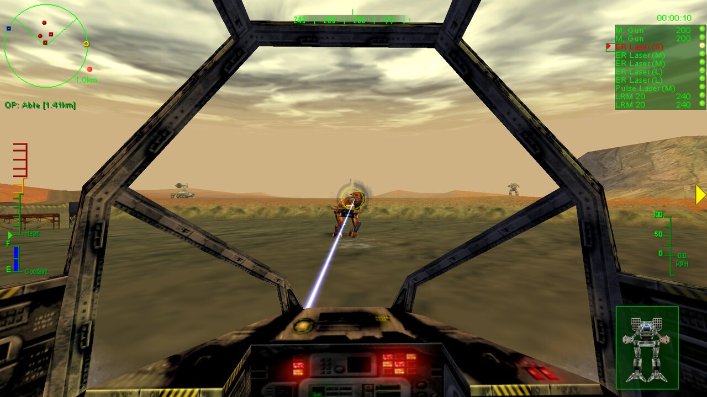
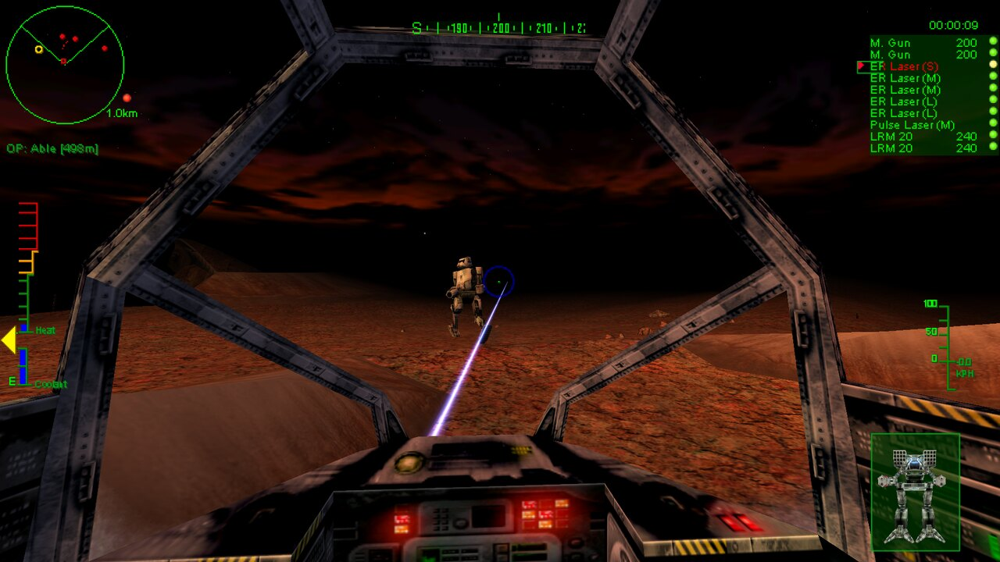

# Pirate's Moon Rebuild

An unofficial fan rebuild of **MechWarrior 3: Pirate's Moon** (Zipper
Interactive and MicroProse, 1999), the expansion to MechWarrior 3, for
today's computers: Windows 10 and 11, macOS and Linux, with no Wine, DirectX
wrappers, DDrawCompat or dgVoodoo.

| | |
|---|---|
|  |  |
|  |  |

It is not a remake. Pirate's Moon's own `Mech3.exe` (1.0) was taken apart and
its code rewritten, on the engine of the [MechWarrior 3 rebuild](https://github.com/telltaleatheist/mech3-re)
(the same studio's same code base, so only what the expansion changed was
ported again), function by function in C++, most of it checked against
the original running in an emulator. The game plays the way it always did,
minus the bugs and the problems it has on modern machines. It is a personal
learning project: free, not sold, and not affiliated with or endorsed by
Microsoft or MicroProse.

This repo is Pirate's Moon. The launcher, named **BattleTech**, downloads,
installs and updates each game of the family:

- **MechWarrior 3**, rebuilt from its own exe
  ([mech3-re](https://github.com/telltaleatheist/mech3-re), with the launcher);
- **Pirate's Moon**, the expansion, rebuilt as above (this repo);
- **MechWarrior 1: Reverse Engineered** (MW1 Rebuild for short), MechWarrior
  (1989) reverse engineered and rebuilt in C++, built on
  [Elthial's SDL port](https://github.com/Elthial/Mechwarrior-sdl-port)
  ([mech1-re](https://github.com/telltaleatheist/mech1-re));
- **MechWarrior 1 Remake** (formerly MW1: Critical Hit), a fan remake of
  MechWarrior (1989)'s mercenary campaign on MechWarrior 3's combat, worlds
  and 'Mechs ([mech1-remake-re](https://github.com/telltaleatheist/mech1-remake-re));
- **The Crescent Hawk's Inception** (1988), rebuilt
  ([inception-re](https://github.com/telltaleatheist/inception-re)). An
  Inception Remake is coming.

Each game also starts on its own, and each comes as a separate download
too. Pirate's Moon is `mw3pm`, its own program, with its own saves and
settings; it does not need MechWarrior 3 installed.

**No game files are included.** You need your own Pirate's Moon (an
installed copy, its disc or a disc image).

> Found a bug? Please [report it](#reporting-a-bug).

Much of this read-me describes MechWarrior 3 and the launcher, which
Pirate's Moon shares: the same setup, controls, options, mods and fixes,
with the expansion's own campaign, 'Mechs, weapons and AI.

## What's new

Every release's full notes are on the [Releases](../../releases) page, and
[CHANGES.md](CHANGES.md) lists everything the rebuild changes from the
original.

**1.8.1 (2026-11-28)** (the release page is
[docs/release-page-pm-1.4.1.md](docs/release-page-pm-1.4.1.md)): updating a
Windows zip copy from inside the game works (1.4.0's could not move the game's
folder, so that copy is downloaded by hand once); a new version found at the
start is a small notice in the corner with the keys to press, not the update
question over the game; a copy at the very top of a drive says up front that it
can't update itself. Pirate's Moon alone: 1.4.1.

**1.8.0 (2026-11-28)** (the release page is
[docs/release-page-pm-1.4.0.md](docs/release-page-pm-1.4.0.md)): a setup menu
inside the game (Cmd + Shift + F1 on the Mac, Shift + Alt + F1 elsewhere)
shows the game files in use, reports a problem, checks your files, resets the
settings and opens the Upgrades page, pausing the game while it is open (in a
multiplayer game it can't pause, and says so); its UPDATES page updates the
game from inside it; RUMBLE on the Game
Options screen turns a pad's rumble off; a gamepad's throttle keeps Assign
Axis's zero point, stopping at rest; the salvage and debriefing lists' scroll
arrows click; in multiplayer, mobile field bases have their repair stations,
skipping the map's fixed repair point. Pirate's Moon alone: 1.4.0.

**1.7.0 (2026-11-27)** (the release page is
[docs/release-page-pm-1.3.0.md](docs/release-page-pm-1.3.0.md)): started on its own
without game files, the game offers to download the original files; a disc in
a drive is found; the setup takes reverse-engineered.com's compact copy of the
original files; a dropped download picks up where it stopped; a crash at quit
after the sound output changed is fixed (SDL 3.4.20). Nothing in play changes.
Pirate's Moon alone: 1.3.0.

**1.6.1 (2026-11-27)** (the full notes are in
[docs/release-notes-1.6.1.md](docs/release-notes-1.6.1.md)): the Mac app is
signed and notarized, so it opens like any other app; the release's checksums
are signed, so the launcher can take it from the mirror. Nothing in play changes.
Pirate's Moon alone: 1.2.12.

**1.6.0 (2026-11-26)** (the full notes are in
[docs/release-notes-1.6.0.md](docs/release-notes-1.6.0.md)): the mouse wheel
scrolls the menus' lists (issue #20, under SMALL FIXES); each game sets
itself up and the launcher only asks it, with its own menu sounds and a
download about 40% smaller; new games can appear in the launcher without an update.
After updating the launcher, press UPDATE ALL.

**1.5.2 (2026-11-25)** (the full notes are in
[docs/release-notes-1.5.2.md](docs/release-notes-1.5.2.md)): RAW MOUSE is on
the Game Options screen under MOUSE SENSITIVITY, off on the Mac (switched off
once with this update), and MOUSE SENSITIVITY goes down to 0.1; on a Mac the
Dock no longer shows the updated launcher as a folder.

**1.5.1 (2026-11-25)** (the full notes are in
[docs/release-notes-1.5.1.md](docs/release-notes-1.5.1.md)): a launcher fix.

- On a Mac the launcher could use tens of gigabytes of memory while a
  full-screen game covered it.
- It finds MechWarrior 1 Rebuild and Inception installed by their own Setups,
  and sets them up on its own screens.

**1.5.0 (2026-11-24)** (the full notes are in
[docs/release-notes-1.5.0.md](docs/release-notes-1.5.0.md)): the launcher is
drawn sharp at any window size; each game's files and copies are on its gear
page; CHECK FOR UPDATES checks every game and the launcher.

**1.4.1 (2026-11-24)** (the full notes are in
[docs/release-notes-1.4.1.md](docs/release-notes-1.4.1.md)): a fix: Inception's
game files can be changed at any time, and every find screen has PICK A FILE.

**1.4.0 (2026-11-24)** (the full notes are in
[docs/release-notes-1.4.0.md](docs/release-notes-1.4.0.md)): the launcher sets up
Inception on its own screens, shows every file in its pickers, reads zips in ADD
FROM MY DISC, and finds Pirate's Moon's data from Windows versions up to 1.3.1.

**1.3.6 (2026-11-24)** (the full notes are in
[docs/release-notes-1.3.6.md](docs/release-notes-1.3.6.md)): fixes: Linux with
NVIDIA loading a mission, the silent menu buttons, MechWarrior 1 Remake's
buttons.

**1.3.5 (2026-11-24)** (the full notes are in
[docs/release-notes-1.3.5.md](docs/release-notes-1.3.5.md)): the launcher
finds MechWarrior 3 and Pirate's Moon installed without it and links them,
and each game's gear opens its page: where it's installed, link another
copy, unlink, uninstall.

**1.3.4 (2026-11-24)** (the full notes are in
[docs/release-notes-1.3.4.md](docs/release-notes-1.3.4.md)): GAME FILES lists
every copy of a game on your computer and what each is missing, so you pick
the one to use; every launcher screen says BATTLETECH.

**1.3.3 (2026-11-24)** (the full notes are in
[docs/release-notes-1.3.3.md](docs/release-notes-1.3.3.md)): the launcher
lists the games as panels that scroll, like the download page.

**1.3.2 (2026-11-23)** (the full notes are in
[docs/release-notes-1.3.2.md](docs/release-notes-1.3.2.md)): the BattleTech
launcher, and fixes.

- **The BattleTech launcher:** one card for each game family, with its games
  as tabs; it checks for its own updates.
- **Your folders move from MicroProse to BattleTech** on the first start (a
  rename, nothing copied).
- **Fixes:** a crash starting a campaign mission on Linux, low frame rates on
  Windows 10, the MFB command, game files from an older install on another
  drive.

**1.3.1 (2026-11-22)** (the full notes are in
[docs/release-notes-1.3.1.md](docs/release-notes-1.3.1.md)): each game goes
where you choose.

- **Install each game where you want,** on any drive: the launcher's DOWNLOAD
  asks the first time, and each game's setup puts its game files, music and
  converted movies there too. Pilots, saves, settings and mods stay in your
  user folder.
- Each game's setup shows its own name instead of "MW3 Rebuild".

**1.3.0 (2026-11-22)** (the full notes are in
[docs/release-notes-1.3.0.md](docs/release-notes-1.3.0.md)): the launcher
downloads the games.

- **The launcher's download is the launcher alone.** Each game's card shows
  DOWNLOAD, or UPDATE TO x.y.z when a newer version is out, and gets the game
  from its own release. Nothing downloads until you press it, every download
  is checked, and your game files, pilots, saves and mods are kept. Offline,
  installed games just play, and ADD FROM FILE takes a game's download
  you already have.
- MechWarrior 1 Remake gets a download of its own (1.0.7).

**1.2.4 (2026-11-22)** (the full notes are in
[docs/release-notes-1.2.4.md](docs/release-notes-1.2.4.md)): a small fix.

- Standing up from a crouch obeys the sound volume, in MechWarrior 3 and
  Pirate's Moon (the original played it at full volume).

**1.2.3 (2026-11-21)** (the full notes are in
[docs/release-notes-1.2.3.md](docs/release-notes-1.2.3.md)): setting up your
games is simpler, and always your choice.

- **Your files are copied in**, so the copy, zip or disc image you set a game
  up from can be deleted afterwards; a game folder put next to the program is
  found whatever it is called.
- **Always your choice**: what a game finds is only offered ("USE THESE GAME
  FILES?"), and holding Shift at a game's start lets you choose again.
- Pirate's Moon and MechWarrior (1989) are set up the same way.
- MechWarrior 1 Remake 1.0.6: its new name on the window and save folder,
  reach contracts that can be reached, the arctic defence contract back.

**1.2.2 (2026-11-21)** (the full notes are in
[docs/release-notes-1.2.2.md](docs/release-notes-1.2.2.md)): fixes from your
bug reports, for all three games.

- **Raw mouse**: the mouse moves exactly as far as you move it, without the
  system's acceleration (RAW MOUSE on the Upgrades page); MOUSE SENSITIVITY
  goes to 5.0.
- New key bindings work at once, rumble pads keep their bindings, free look
  on the middle mouse button, no Linux crash at a mission's start.
- MechWarrior 1 Remake 1.0.5: varied 'Mech prices and out-of-bounds lines on
  every map.

**1.2.1 (2026-11-21)** (the full notes are in
[docs/release-notes-1.2.1.md](docs/release-notes-1.2.1.md)): a fix release
for MechWarrior 1 Remake, now 1.0.4.

- **Every contract can be won**: Desolation Ridge's "destroy the pirate base"
  put its target beside your start, so the mission never ended; every
  contract map is now checked.
- No freeze switching the damage display (D) at high resolution; the arctic
  maps cool your 'Mech faster; smoother HUD shapes.

**1.2.0 (2026-11-20)** (the full notes are in
[docs/release-notes-1.2.0.md](docs/release-notes-1.2.0.md)):

- **Ultrawide screens** (21:9, 32:9) filled without stretching, with
  2560x1080, 3440x1440, 3840x1080 and 5120x1440 in the graphics options.
- **Joysticks**: buttons 11 to 15 can be bound, and a stick plugged in while
  the game runs works without a restart.
- **A new launcher**: a card for each game, named BattleTech, in a window (on
  a Mac its file pickers now open in a second, not 7 to 12); MW1: Critical
  Hit 1.0.3.

**1.1.3 (2026-11-20)** (the full notes are in
[docs/release-notes-1.1.3.md](docs/release-notes-1.1.3.md)):

- **Three games on one launcher**: MechWarrior 1 Remake 1.0.1, a fan remake of
  MechWarrior (1989) on the rebuild's engine, joins the combined package. The
  launcher finds your MechWarrior (1989), or takes its folder or the .zip it
  came in.
- **Music that should repeat now repeats**, and a disc plays on to the next
  track.
- Fixes: a machine gun's sound stuck on after firing (a small fix), memory
  growing mission after mission, Pirate's Moon's lance orders going to the
  first lancemate.

**1.1.2 (2026-11-15)** (the full notes are in
[docs/release-notes-1.1.2.md](docs/release-notes-1.1.2.md)):

- **Both games are ported whole**, the developers' tools and unused code
  included, kept as the original has them.
- **Pirate's Moon behaves like its own** in its menus, briefings, Instant
  Action line-ups, mission look, sensors, field bases and multiplayer; Ctrl+P
  saves a screenshot.
- **Distant ground and walls no longer shimmer** (mipmaps), in both games.
- Fixes: the pause's Escape silencing the mission, a missile locked on a mech
  that left the game, damaged model files, the mod check with a world loaded.

**1.1.1 (2026-11-13)** (the full notes are in
[docs/release-notes-1.1.1.md](docs/release-notes-1.1.1.md)):

- **Pirate's Moon plays by its own rules** where 1.1.0 still used
  MechWarrior 3's: multiplayer salvage, field base repairs, which weapons can
  bear, weapon lights, group fire, and the AI's firing and lance orders.
- **MechWarrior 3:** the radar's view wedge on the mission map, the ER PPC's
  HUD static, equipment and engine-hit callouts, and the zoom window's range
  when aimed at the sky.
- Two crash fixes: a laser turret firing as a mission ends, and a lance order
  on something with no vehicle behind it (Pirate's Moon).

**1.1.0 (2026-11-12)** (the full notes are in
[docs/release-notes-1.1.0.md](docs/release-notes-1.1.0.md)):

- **One download holds both games**, MechWarrior 3 and Pirate's Moon, with a
  launcher to pick between them.
- **Mods are played by campaign** from a new MODS screen, and community mods
  are imported straight from their installers, without running them.
- **Instant Action and multiplayer with mods**: each has its own MODS tab;
  in multiplayer the host decides and everyone needs the same mods.
- **An UPGRADES page**: the one bug-fixes switch becomes five (water
  movement, MFB regroup, improved AI, Artemis tracking, small fixes).
- Fixes from the playtests: the Windows cursor stuck at the centre, a slow
  mouse not moving the aim, the game's boxes in its own look, and more.

1.0.1 to 1.0.5 (2026-11-03 to 11-07)

**1.0.5 (2026-11-07)**

- **No crash ending a mission with a laser firing.** If a beam was still firing when
  a mission ended, the cleanup treated it as a shot and could crash, for example on
  REPLAY at the debriefing.
- **A loadout past 16 weapons can't damage the game.** The game took a 17th weapon
  unchecked and overwrote what came after the list. A mod's mech could do that,
  and so could a modified player's loadout in multiplayer. The extra weapon is now
  refused and named in the log.
- **Walls and footing match the original more closely.** Mech collision and the
  feet's ground probes now do their sums at the precision the original game really
  runs at. In tests they agree with it exactly; in play the difference is rare and
  small.

**1.0.4 (2026-11-07)**

- **The launcher's buttons have their text on Linux.** It looked for a font at
  fixed places and drew empty buttons if none was there. It now brings its own,
  and on all systems the launcher wears that font.
- **No game fonts is no longer blank menus.** An install without Arial, Impact
  and Lucida Console uses your system's on Windows and Mac. With none there, or on
  Linux, it shows its text in free stand-ins the package brings, at the original's
  line heights.
- **Rain and snow stop under roofs and in tunnels.** The check was ported but
  never connected, so they kept falling indoors.
- **`--check-mod` passes a mod with a new world.** It refused every good
  `gamez.zbd`, `anim.zbd` and `texture*.zbd` as "not an archive". Only the check
  was wrong. It also no longer stops at a long folder path.
- **Artemis in a side torso works.** The game looked for it in the wrong
  place, so launchers there never got its better tracking. Stock loadouts with
  Artemis in a side torso now do.
- **Difficulty changes how much damage you take again.** Every release so far
  gave your side the High figure on every difficulty. The game's own table now
  applies: 40% on Low, 70% on Medium, 100% on High. **Low and Medium get
  noticeably easier.** Low also loses a heat haze the original doesn't have
  there.
- **A locked Artemis missile no longer crashes the game.** One flying under 10 m
  over the ground with a clear line did.
- **Ctrl+I in the mech lab keeps your loadout.** Importing a loadout read the
  file, added nothing and renamed the file `.done`, so it seemed to vanish. It
  now adds the loadout. If you lost one, take `.done` off its name in the
  `import` folder and press Ctrl+I again.
- **Accented and non-English letters on Windows.** A folder like `D:\Café`, or
  a Windows user name with an accent, stopped the game from starting. Windows
  10 version 1903 or later now handles them, and pilots saved under a garbled
  name get their right name back.
- **The debrief at 16:9.** The screen's three columns now sit together in the
  middle, and the extra width stays open at the sides.
- **A possible crash after a blown-off limb,** when a mission restarted, is
  gone.
- **The same acceleration above 83 fps.** Holding a throttle key above about
  83 fps skipped the mech's slow build-up of speed, so it pulled away nearly
  2 seconds sooner than at 30 or 60 fps. It now builds up the same at any
  frame rate.
- **Walking into a building does its full damage at any frame rate.** An
  earlier fix scaled the 20 damage of each touch by the frame time, so the
  higher your frame rate the less a building took (about a fifth at 144 fps).
  Each touch does 20 again, as in the original.
- **Where a foot reads the ground.** The original never filled in the setting
  that decides when a foot uses the ground under its middle. Our fix guessed
  at it; it now uses the value the original team's own Pirate's Moon sets. This
  changes slightly how feet sit on slopes and when a foot counts as in water.
  This is part of bug fixes.
- **The target keys tell the HUD again.** Choosing a target with E, W or their
  Ctrl and Shift forms now does what Z and Q already did: the target triangle
  pulses, the target's mech sound plays, and a missile lock starts over on the new
  target instead of carrying across.
- **A stick's throttle lever stays the right way round.** Tapping throttle-down
  with the lever below stop, or pressing Toggle throttle direction (Backspace or
  stick button 10) with it above stop, could leave the lever backwards until the
  mission ended. That toggle no longer affects a lever. If yours runs backwards
  from the start, use the Invert box (Options, Controls, Assign Axis).
- **Op 2 Mission 2's gas kills.** After the Air Refinery goes down, standing in its
  gas now destroys you, or Dominic, as the original does; before, nothing happened.
- **The debriefing's scores.** A campaign debriefing now lists the mission's
  objectives, each worth 2500 when done, and counts them in the mission and
  campaign totals and the rank; before, it listed none and scored none. Instant
  Action's Battle Waves and Progression now score 1000 a wave plus a bonus for
  how far you got, as the original does, in place of a flat 1000, so a round that
  clears no wave scores nothing but its kills. Scores you already have stay as
  saved; new missions add to them.
- **A mission load that stops says where.** The log now names the load step that
  has gone quiet and for how long.

**1.0.3 (2026-11-05)**

- **Your data folder can live on another drive:** GAME FILES, MY DATA FOLDER in the
  launcher (now on each game's gear page) copies it, checks the copy, then switches over, and removes the old
  copy only if you say so. If the drive is missing at start the game says so
  instead of starting afresh.
- **Linux:** the game no longer closes at the end of the intro movies.
- **Linux:** an install in any letter case now works (all lower case, all upper
  case, or mixed).
- **A softer message for mods:** when files match neither 1.0 nor 1.2, it now says
  data mods are read, though they may not play right, and that a mod which
  patches the old Mech3.exe won't apply. It never stopped the game.
- **Crashes say why:** a crash or a failed start now leaves a line in the log
  and shows a message box, on every platform.
- **Windows:** the installer asks for a folder every time, so you can install
  somewhere other than C.
- **Vehicles on fast machines:** small bumps throw them much less. On rough
  ground they still tip more than at 30 fps, and they still jump off steep
  banks at full speed, as in the original.
- **A band under the sky:** where nothing is drawn between the far ground and
  the sky, the game now shows the fog's color.
- Smaller fixes: a memory leak in the zoom views, a light's position, and the
  pitch of moving sounds.

**1.0.2 (2026-11-04)**

- **Lancemates walk round things.** When a straight walk fails, they find a
  way round walls, up ramps and across rivers. Part of bug fixes; not for
  enemies or in multiplayer.
- **Lights made during play work.** Jump jets and gunfire light your mech.
- **A mech no longer walks by itself** when saved stick controls are used with
  no stick attached.

**1.0.1 (2026-11-03)**

- **Op 1, Mission 2's missile platforms** no longer vanish at high frame rates,
  which could make the mission impossible to win.
- **Custom key bindings** work on the Controls screen.
- **Flight sticks:** twist and throttle reach the right axes, and the throttle
  lever reaches reverse.
- **A crash late in a fight** is fixed, along with the end credits on wide
  screens and the mech lab's "Overwrite?" box.

## What you need

- **Your own MechWarrior 3**, any of these:
  - an installed copy, version 1.2 or 1.0 (the rebuild makes the 1.2
    patch's changes itself as 1.0's data loads, so it plays as 1.2; your
    files are not changed);
  - the original disc;
  - a disc image: an `.iso`, or a `.cue` with its `.bin` files (a `.cue`
    also gives you the music).
- **A computer** with a graphics card that does Direct3D 12 (Windows), Metal
  (Mac) or Vulkan (Linux):
  - Windows 10 or 11, 64-bit;
  - macOS 12 or later, Apple silicon or Intel;
  - Linux, x86-64, with your distribution's Vulkan driver.

Pirate's Moon, the expansion, is a program of its own that the launcher
downloads, and needs your own Pirate's Moon the same way (an installed copy,
its disc or a disc image). Each game works without the other.

MechWarrior 1 Remake needs your own MechWarrior (1989), MechWarrior 3 and
Pirate's Moon: it is fought on their worlds with their 'Mechs. The launcher
looks for MechWarrior (1989) in the usual places; if it isn't there, a click
takes its `BTECH.EXE`, its folder or the `.zip` it came in.

## Download

The launcher is on the [mw3-re Releases](https://github.com/telltaleatheist/mw3-re/releases)
page (and [reverse-engineered.com](https://reverse-engineered.com)); it
downloads each game when you press its DOWNLOAD:

| | File | |
|---|---|---|
| Windows | `MW3-Rebuild-Setup-<version>.exe` | An installer. A `.zip` of the same files is there too. |
| Mac | `MW3-Rebuild-<version>-mac.dmg` | Drag the app to Applications. |
| Linux | `MW3-Rebuild-<version>-x86_64.AppImage` | Make it executable (`chmod +x`) and run it. |

This repo's [Releases](../../releases) hold Pirate's Moon alone
(`PM-Rebuild-*`), without the launcher.

**On a Mac:** from 1.6.1 (Pirate's Moon alone from 1.2.12) the app is signed
and notarized by Apple, so it opens like any other app. An older copy is not
signed, and macOS stops it the first time you open it ("Not Opened"; click
**Done**, not Move to Trash).

- **macOS 15 Sequoia and later:** open **System Settings > Privacy &
  Security**, scroll down to the line about BattleTech, click **Open
  Anyway**, then **Open** (and your password if asked). Right-click > Open
  no longer gets past it on these versions.
- **macOS 12 to 14:** right-click (or Control-click) the app, choose
  **Open**, then **Open** again. Open Anyway in Privacy & Security works
  there too.

macOS remembers your choice after that.

**On Windows**, SmartScreen may warn about an unknown publisher: click
**More info**, then **Run anyway**.

## The first start

Start **BattleTech** (the launcher; **MechWarrior 3** in the MechWarrior 3
alone download). Each game is a panel in a list that scrolls: **DOWNLOAD**
gets a game, **PLAY** starts it, and **UPDATE** appears beside PLAY when a
newer version is out. Press **PLAY** on MechWarrior 3: it goes straight into the game
when it finds your install: where the original installer put it, `Program Files`,
`C:\Games`, a Wine, Proton or Lutris copy on Linux and the Mac, or a copy it
installed itself earlier. It says which version it found in its log.

**If it finds none**, choosing MechWarrior 3 opens a screen that finds
your game. From the launcher, once the game is there you are back on the
launcher's games, so you can set up Pirate's Moon too, then click the game
to play; a plain `mw3` start (that screen only) goes straight on into the
game:

- **Find the game** searches this computer and your disc drives first and
  uses what it finds, with nothing to pick. If there is nothing, one
  picker opens: choose a disc image or download (an `.iso`, a `.cue` with
  its `.bin` files, whose CD audio becomes the music, or a `.zip`, `.7z` or
  `.rar` holding any of those, even a zip inside a zip; nothing needs
  unpacking by hand), or `Mech3.exe` (or any file) in an installed copy,
  which means that whole folder.
  It looks inside first and says what it found ("The MechWarrior 3 disc
  version 1.0, with its music (2 CD tracks)"), then copies what the game
  needs into a folder of the rebuild's own, with a progress bar and
  **Cancel**. An installed copy is used where it is. No Windows and no
  original installer needed. Versions 1.0 and 1.2 both work as they are:
  1.0 plays as 1.2. Pirate's Moon is found or installed the same way, from the
  game's gear page in the launcher.

If something is wrong (not enough space, a damaged download, a file that
is not MechWarrior 3) it says so in plain words and changes nothing.

- **The launcher**, installed as "BattleTech" (the Start-menu and desktop
  shortcut on Windows, the Mac's app, the Linux desktop entry; a search for
  "MechWarrior 3" finds it too), is the rebuild's own front screen, in a
  window: a panel for each game. It starts the game and closes as soon as
  the game's first frame is on screen (if the game fails to start, it stays
  and says so). The **gear** beside a game's button opens its page: where
  it's installed, **GAME FILES** (the same find-your-game screen, any time:
  another copy, installing again from your disc, adding movies and music it
  lacks, MY DATA FOLDER), the copies found on this computer, and link,
  unlink or uninstall. **CHECK FOR UPDATES** checks every game and the
  launcher. `mw3` (`mw3.exe`) also starts the game directly. The arrow keys and a gamepad
  work in the launcher as well as the mouse.
- Before the first game it tells you anything worth knowing about your
  copy: no movies (a CD-type install leaves them on the disc), no music, or
  game files of an unknown version. **Add from my disc** there takes what
  is missing from your disc in a drive, a disc image or the disc's folder.
- **The movies** play from your own copy. Where they cannot be played
  directly, the rebuild converts them once, the first time (about a minute).

Your MechWarrior 3 files are only ever read, never changed.

## Music

The original played its music from the CD's audio tracks, which an
installed copy does not have. Two ways to get it back:

- From a disc image that kept the CD audio (a `.cue` with its `.bin`
  files): in the launcher, the gear beside MechWarrior 3, **GAME FILES**,
  then **ADD FROM MY DISC** (there while the music is missing), and pick the
  `.cue`, or the `.zip` that holds it with its `.bin` files. Its audio
  tracks become the music. Installing the game from the `.cue` (**PICK A
  FILE** on the same screen) brings the music in at once. An `.iso` has no
  music: it keeps only the data track. The Internet Archive has MechWarrior
  3 disc images in `.cue`/`.bin` with the original music
  ([archive.org](https://archive.org/search?query=mechwarrior+3)).
- Your own rip: put the tracks in the rebuild's `music` folder (below) as
  `track02.ogg`, `track03.ogg` and so on (or `.flac`, `.wav`, `.mp3`),
  numbered as on the CD.

## Playing

- The game runs fullscreen at your desktop's resolution, widescreen
  included. **Alt+Enter** switches between fullscreen and a window.
- Ultrawide screens (21:9, 32:9) play at their full width: the view widens
  without stretching, and RESOLUTION offers 2560x1080, 3440x1440, 3840x1080
  and 5120x1440 (contributed by roswellien).
- In a window, press and release **Ctrl+Alt** to free the mouse; click in
  the window to take it back. Switching away frees it too, and coming back
  to a mission (Cmd+Tab, Alt+Tab or a click) takes it again at once; that
  click does not fire.
- **Options > Mouse sensitivity** (ours, under Invert Mouse) sets how fast the mouse aims in a mission; it starts at the original's setting. Click the bar where you want it.
- Gamepads work as they did on Windows 98, and force feedback becomes rumble.
- Flight sticks' axes (twist, throttle lever) go where the game expects
  them. With several devices, `joystick=Part of its name` in `mw3.cfg`
  picks one; an odd stick's axes can be set with `joystick_axes=X,Y,Rz,S0`
  (one word a stick axis: X, Y, Z, Rx, Ry, Rz, S0, S1, or - for none).
  `mw3.log` lists every device found and the line in use.
- A stick's throttle lever covers reverse too: full reverse at the bottom,
  stop a little over a third of the way up. If yours runs backwards, untick
  Invert in Options, Controls, Assign Axis on Forward Throttle, and save
  when Accept asks. Toggle throttle direction (Backspace) is for the keys
  and does not flip a lever. `throttle_reverse=0` in `mw3.cfg` gives the original's
  stop at the bottom (reverse is then Backspace).
- On a widescreen every screen uses the whole width: the missions, the
  menus, the mech lab, the briefings and the multiplayer screens. For the
  original's 4:3 menus, put `widemenus=0` in `mw3.cfg` (or start with
  `--no-wide-menus`).
- The movies keep their shape on a wide screen: the intro and the ending,
  whose black bars were part of the picture, fill the screen's width; the
  4:3 movies are centred with black sides.

### Multiplayer

**Multiplayer** on the main menu plays the original's network games over
the internet or a local network, up to 8 players. DirectPlay, which the
original used, is gone from modern systems, so the rebuild has its own
connection (UDP); IPX, modem and serial play are gone with it. Everyone
plays the rebuild, on any mix of Windows, Mac and Linux.

- **On a local network**, games show up on the connection screen by
  themselves as soon as it opens.
- **Joining by address**: type the host's address (`203.0.113.7`, or
  `203.0.113.7:27930` for another port) and press **Find Game** or
  Enter.
- **Hosting**: **Host Setup**, then **Host**. The game opens its UDP port,
  27930, on your router by UPnP when the router allows it, and closes it
  again when you stop. The connection screen and the lobby show the
  address to give your friends (click it to copy) and your LAN address.
  When the internet cannot reach you, the screen says why and what to do:
  - "forward UDP 27930 on your router to host": no router answered, so set
    up the port forward by hand in your router's settings;
  - "Could not open the port": the router refused UPnP; forward the port
    by hand;
  - "Another router stands in front of yours": a second router (often the
    provider's modem) sits between yours and the internet; forward UDP
    27930 on that one too, or use a VPN such as Tailscale;
  - "Your internet provider blocks hosting": your provider shares one
    internet address between many customers (carrier-grade NAT), so no
    one can reach you from outside. Play on a LAN, or over a VPN such as
    Tailscale; joining other people's games still works.
- **Leaving a match**: Escape shows "Are you sure you want to quit?". With
  bug fixes on (below) the match goes on while it is up, so you can still
  move and fire; **Y** leaves
  for the main menu, **N** or Escape closes the box. The others see you
  leave at once. A match also keeps running when its window is in the
  background, so your 'Mech is never a frozen target.
- **Mods**: the multiplayer screen's MODS tab ticks the mods to play with
  (the game starts again with them). The host decides; a player whose mods
  are not the same is turned back and told which mod is missing or
  different. Players on 1.0 and 1.2 game files play together.
- **Pilot names**: two players can't use the same name (the original refuses
  the second). Change NET NAME on the multiplayer screen, or click PILOT
  ENTRY on the pilot screen and type a new pilot's name.

### Bug fixes, and playing exactly like the original

The rebuild fixes the original's bugs where the intent is clear: things that
ran faster on a fast computer, the mobile field bases that would not come
back, lancemates walking into walls, and more. Quirks that players know and
plan around are kept. Every change is listed in plain words in
[CHANGES.md](CHANGES.md).

The fixes that change play are grouped under five switches on the
**UPGRADES** page in the options (in the menus and in a mission), all on
to start: WATER MOVEMENT, MFB REGROUP, IMPROVED AI, ARTEMIS TRACKING and
SMALL FIXES (the page lists what the small fixes are). Turn one off and that
part plays as in 1999. To play exactly as the original did, turn all five
off, or start with `--original` for one run. In a network game everyone
plays on the host's switches. The changes the game needs to run on a modern
computer, and crash fixes, always stay on.

### Cheat codes

The rebuild adds cheat codes (ours, not in the original) for the campaign,
Instant Action and training; a network game refuses them. In a mission,
press **Shift+Enter** (or **Keypad \*** or **Keypad −**) to open a one-line
box, type a code and press **Enter**; **Esc** closes it. The mission keeps
running while you type. Capitals and extra spaces don't matter. A code
lasts until the mission ends; the ones that switch something on switch it
off when typed again. The message panel says what was turned on or off.

| Code | What it does |
|---|---|
| `black sheep wall` | Every mech and vehicle on the radar, at any range |
| `power overwhelming` | Your mech takes no damage |
| `operation cwal` | Your weapons reload and your mech cools ten times as fast |
| `food for thought` | Maximum salvage: every chance in the salvage goes your way |
| `there is no cow level` | Wins the mission: every enemy mech and vehicle destroyed by you and salvaged whole, every objective done |
| `game over man` | Loses the mission |

A mission won with a code counts as won. In a network game the keypad keys
stay the chat's. More in [docs/cheats.md](docs/cheats.md).

## Mods

Mods are turned on per campaign, inside the game, on the **MODS** screen
(main menu). A fresh start always plays the original game: nothing is modded
until you turn it on.

1. **MODS** on the main menu. The left box lists the campaigns (the game's
   own first), the right box the mods you have.
2. **IMPORT** adds a mod: pick the file you downloaded.
3. Click a mod's **box** to turn it on for the campaign chosen at the left.
4. **PLAY** starts that campaign with its ticked mods. Each campaign keeps
   its own ticks, pilots and saved games, apart from the main menu's.

**MISSIONS** plays any one mission of the chosen campaign at once (nothing
is kept), **INFO** says what a mod changes, and each button says what it
does when the mouse is over it. A mod never touches your install or your
main-menu pilots.

### Importing a community mod (the weapons mods, map packs)

Community mods were made for the original game and mostly come as an
installer program.

1. Download it. **Do not run its installer**: it is made for the original
   game and would overwrite that game's files.
2. In the rebuild: MODS, IMPORT, and pick the downloaded file (the .exe
   installer itself, a .zip/.7z/.rar, or a file inside an unpacked folder).
   The rebuild reads the mod out of it without running it.
3. Click its box for a campaign, then PLAY.

IMPORT may say "N warnings": files in the mod the game cannot use as they
are (often slips that also trouble the original). The rest of the mod is
added; INFO lists each warning and what was done about it.

Pirate's Moon has its own MODS screen. A Pirate's Moon mod imported in
MechWarrior 3 (or the other way round) is handed to the other game, which
adds it at its next start, and a box says so; with the game started without
the launcher, the box says to IMPORT it in the other game. In multiplayer
every player needs the same mods.

Mods live as folders in a `mods` folder inside the settings folder (below),
laid out like the game's own files, each with a short `mod.txt`. `mw3
--mods` lists what it found, and `mw3 --check-mod FOLDER` reads a mod as
the game would and says what it would refuse. How to make one:
[docs/modding.md](docs/modding.md).

To build or change a world, use [zStudio](https://github.com/Vorta/zStudio) by Vorta
(Windows): it unpacks the game's files into the editable source tree Zipper's own team
worked from, and builds them back into game files you can ship as a mod.

The game editor itself (the original's own, opened to players: the AI's paths, the
vehicles' AI, new weapons, saved into your own copy of a campaign) is reached from
MODS: MISSIONS, a mission, PLAY, then EDIT MISSION on the pause menu (or Shift+F12).
It has a guide: [docs/editor-guide.md](docs/editor-guide.md).
In the game every field, button and menu row has a tip, and the menu's HELP row gives a
quick start.

The original game has a tool of its own here: [tools/weapon-patch](tools/weapon-patch)
adds weapons to the original `Mech3.exe`'s mech lab. It isn't part of the rebuild.

## Where your saves and settings go

| | Folder |
|---|---|
| Windows | `%APPDATA%\BattleTech\MechWarrior 3\` |
| Mac | `~/Library/Application Support/BattleTech/MechWarrior 3/` |
| Linux | `~/.local/share/BattleTech/MechWarrior 3/` |

It holds `mw3.cfg`, your pilots and saves, the settings, your mods, the
converted movies and the music, and `mw3.log`. Pirate's Moon keeps its own
beside it, in `BattleTech/Pirate's Moon`, and the other family games theirs.
Versions up to 1.3.1 used `MicroProse` instead of `BattleTech`: the first
start of a newer version moves your folder across by itself (nothing is
copied or lost) and leaves a note in the old place so an older version still
finds it. Uninstalling the rebuild keeps
them; deleting one starts that game over. GAME FILES on a game's gear page in
the launcher, then MY DATA FOLDER, moves a game's folder to another drive.

## Known issues

- **macOS: window tools can delay the mouse button by about a second.**
  Tools that filter mouse clicks to snap or move windows (Magnet and
  similar) can hold each mouse-button press back, so in a mission the mouse
  fires only when you let go. The keyboard is not affected. Quit the tool
  while you play, or add BattleTech (MechWarrior 3 in the MechWarrior 3
  alone download) to its excluded apps if it has that setting.

## Reporting a bug

Open an [issue](../../issues) and include:

- what you did and what happened (a screenshot helps);
- the mission, and whether it happens with `--original` too;
- your system (Windows, Mac or Linux, and the version);
- **`mw3.log`** from the folder above. It is written new at every start and
  the one before is kept as `mw3.old.log`, so if you started the game again
  after a crash, send `mw3.old.log`.

## Hidden mechanics

Taking the game apart turned up hundreds of hidden mechanics, quirks and
bugs, collected for players in [docs/discoveries.md](docs/discoveries.md).
A few:

- Lasers never cause critical hits, and criticals only happen once a part's
  armor is down to 15%.
- Ammo criticals don't explode: they just empty a bin. CASE in a side torso
  does nothing at all, and the stock Mad Cat carries both of its CASE there.
- Ultra autocannons never jam; they simply fire twice as fast.
- TAG works, but the missiles home on the spot you marked, not the target,
  and take 7 seconds to arrive.
- Pilot files track hidden Instant Action and multiplayer stats that the
  game never shows.

**For the curious:** start with `--debug-camera` (or put `debugcamera=1`
in `mw3.cfg`) and press **Shift+F12** in a mission to open the game editor
the original carries but never lets you reach: its menu over the mission,
and the view on the invisible "stealth" camera, flown with the movement
keys. Shift+F12 again puts the view back on your 'Mech. It is a developer's
tool, as it was in 1999: expect rough edges.

## Building from source

See [docs/building.md](docs/building.md). How the code is organised (the
shared engine, MechWarrior 3, Pirate's Moon and the launcher):
[docs/games-layout.md](docs/games-layout.md).

## Credits and licence

- **MechWarrior 3** and **Pirate's Moon** were made by Zipper Interactive
  and published by MicroProse in 1999. **MechWarrior** (1989) was made by
  Dynamix and published by Activision. All the games' content is theirs and
  comes from your own copies.
- The rebuild is under the [MIT licence](LICENSE). The
  original's code was studied with Ghidra and
  [REA](https://github.com/morluto/rea), the data formats cross-checked with
  [mech3ax](https://github.com/TerranMechworks/mech3ax), and the port checked
  against the original in the [Unicorn](https://www.unicorn-engine.org/)
  emulator.
- It runs on [SDL3](https://www.libsdl.org/) (with SDL3_ttf, FreeType and
  SDL3_sound), and converts the movies with a minimal LGPL build of
  [FFmpeg](https://ffmpeg.org/). Each download lists them in
  `THIRD-PARTY.txt`, with their own licence files.
- The launcher is drawn with [RmlUi](https://github.com/mikke89/RmlUi), and
  its lettering is Saira Condensed (SIL Open Font License).

MechWarrior and BattleTech are trademarks of their owners. This project is not
affiliated with or endorsed by Microsoft, MicroProse, Zipper Interactive,
Dynamix or Activision.
