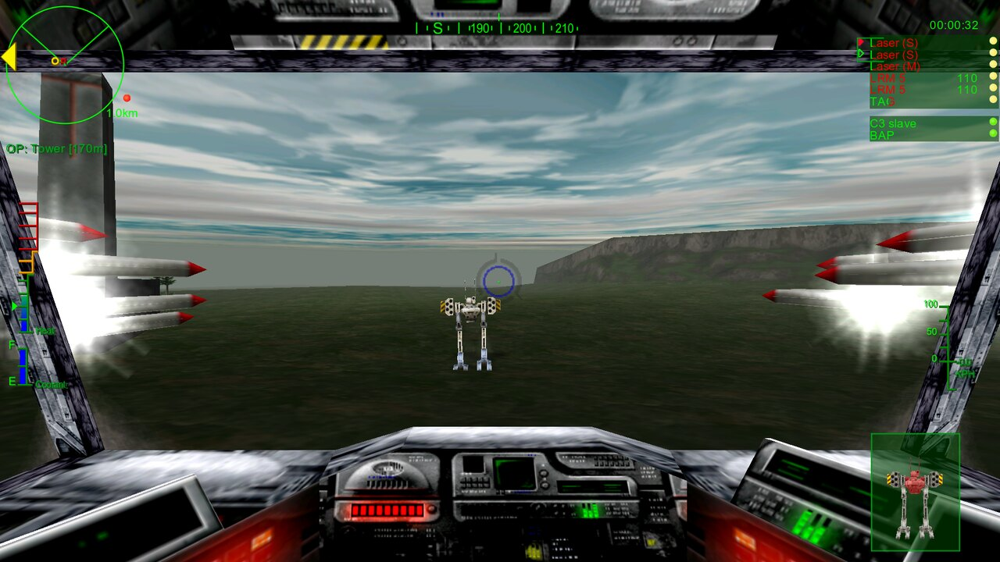
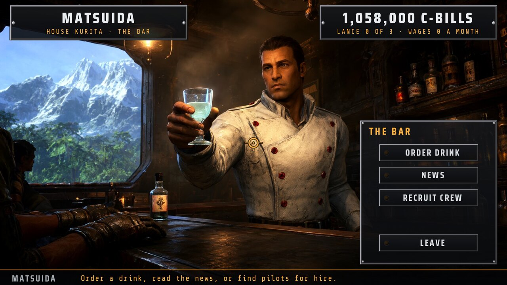
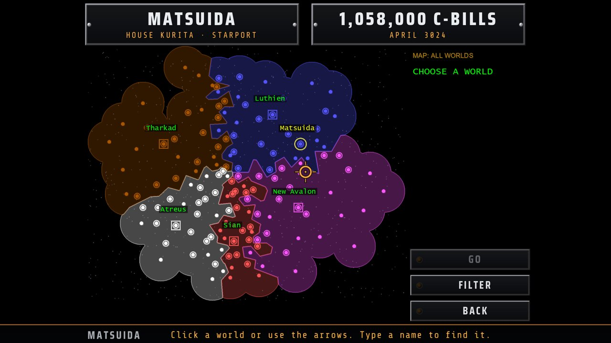
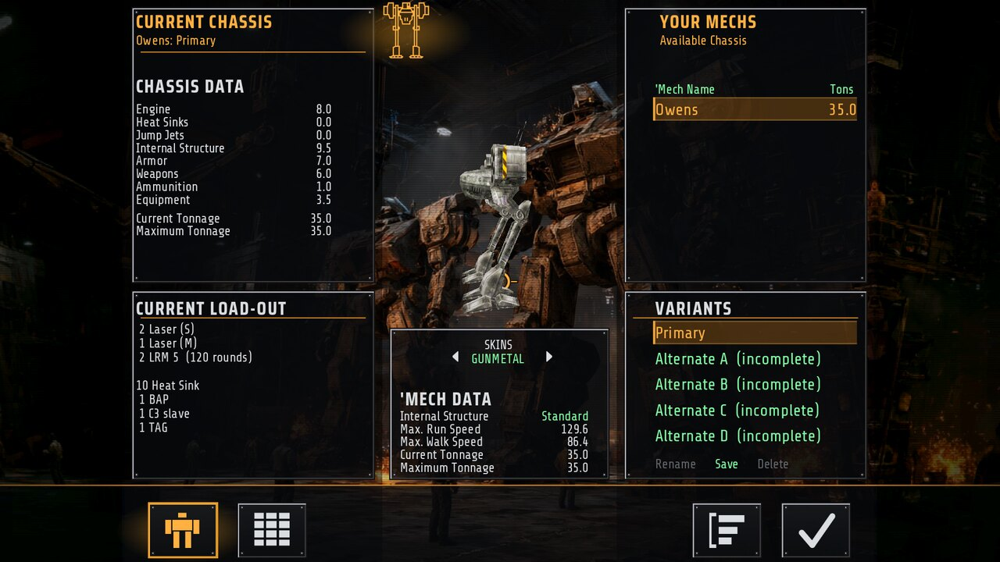

# MechWarrior 1 Remake

A fan remake of **MechWarrior** (Dynamix and Activision, 1989), played on the
engine of the [MechWarrior 3 rebuild](https://github.com/telltaleatheist/mech3-re),
on Windows 10 and 11, macOS and Linux. MW1's mercenary campaign (the worlds,
the Houses, the contracts, the Bar, the 'Mech markets and the long road to
clearing the founder's name) is brought to Pirate's Moon's game, with
MechWarrior 3's combat, Mech Lab and salvage, every 'Mech of MechWarrior 3 and
Pirate's Moon, and new art and music between missions.

| | |
|---|---|
|  |  |
|  |  |

It is not a decompile of MW1 and not a copy of any game. It is a personal
project: free, not sold, and not affiliated with or endorsed by Microsoft,
MicroProse, Zipper Interactive, Dynamix, Activision or Catalyst Game Labs.

**No game files are included.** You need your own copies of the three games
below.

## What you need

- **Your own copies of three games:**
  - MechWarrior (1989, the DOS game, with `BTECH.EXE`);
  - MechWarrior 3;
  - Pirate's Moon, its expansion.

  Your files are only read, never changed. MW1's story, news and briefing text
  come from your copy of MechWarrior.
- **A computer** with a graphics card that does Direct3D 12 (Windows), Metal
  (Mac) or Vulkan (Linux):
  - Windows 10 or 11, 64-bit;
  - macOS 12 or later, Apple silicon or Intel;
  - Linux, x86-64, with your distribution's Vulkan driver.

## Download and install

From the [Releases](../../releases) page. Get **SHA256SUMS** too if you want to
check a file.

| System | File | Install |
|---|---|---|
| Windows | `MW1-Remake-Setup-<version>.exe` | Run it: it adds a Start-menu entry and an uninstaller. `MW1-Remake-<version>-win64.zip` is the same files in a folder: unzip it and run `mw1.exe`. |
| Mac | `MW1-Remake-<version>-mac.dmg` | Open it and drag the app to Applications. |
| Linux | `MW1-Remake-<version>-x86_64.AppImage` | Make it executable (`chmod +x`) and run it. |

- **Mac, the first time:** the app is not signed by Apple, so macOS stops it
  once. On macOS 15 and later click **Done**, then open **System Settings >
  Privacy & Security** and click **Open Anyway**. On macOS 12 to 14,
  right-click the app, choose **Open**, then **Open** again.
- **Windows:** SmartScreen may warn about an unknown publisher. Click **More
  info**, then **Run anyway**.

**The BattleTech launcher** (from [mech3-re](https://github.com/telltaleatheist/mech3-re)
and the [hub's downloads](https://github.com/telltaleatheist/mw3-re/releases))
installs and updates the remake too, and finds your copies of the games for
it.

## Playing

1. Start the remake from the launcher: it has found your game folders and
   passes them on.
2. Started by itself with a game missing, the remake says which, and offers
   the launcher when that is beside it. You can also name the folders yourself,
   once; they are then remembered in `mw1.cfg`:

       mw1 --install <Pirate's Moon> --mw3-install <MechWarrior 3> --mw1-game <MechWarrior 1989>

`mw1 --version` prints the version. Version numbers: the second number is a
feature update, the third is bug fixes.

## What's new in 1.1.2

The enemies on the two ice maps no longer stand still, and in battles and defences the enemies come for you, as in
MechWarrior (1989). RAW MOUSE is under MOUSE SENSITIVITY in SETTINGS, CONTROLS, off on the Mac, and MOUSE SENSITIVITY
goes down to 0.1. The full notes: [mw1/dist/RELEASE-NOTES-1.1.2.md](mw1/dist/RELEASE-NOTES-1.1.2.md).

## What's new in 1.1.1

Buttons have sounds, and a crash while a mission loads on Linux with an NVIDIA card should be fixed. The full notes are in
[mw1/dist/RELEASE-NOTES-1.1.1.md](mw1/dist/RELEASE-NOTES-1.1.1.md).

## What's new in 1.1.0

The full notes are in
[mw1/dist/RELEASE-NOTES-1.1.0.md](mw1/dist/RELEASE-NOTES-1.1.0.md).

- **Permanent upgrades** at the Mech Complex's new SUPPLY screen: heat-sink and
  armour kits your company owns, and power and range steps for a weapon type.
- **An arms dealer** on the same screen, with weapons, ammunition and equipment
  that change with the market.
- **A new soundtrack:** MechWarrior's five songs as rock arrangements, and six
  new combat songs.
- **Never stranded:** a merchant JumpShip takes a stuck company out, free.
- **No deadline, and a graded ending:** the hunt for the Dark Wing is graded on
  how long it took.
- **Saves in the BattleTech folder** (below), moved there by themselves.

## Where your saves and settings go

| System | Folder |
|---|---|
| Windows | `%APPDATA%\BattleTech\MechWarrior 1 Remake\` |
| Mac | `~/Library/Application Support/BattleTech/MechWarrior 1 Remake/` |
| Linux | `~/.local/share/BattleTech/MechWarrior 1 Remake/` |

It holds `mw1.cfg`, your three save slots, the settings and `mw3.log`. Versions
before 1.1.0 used `MicroProse` instead of `BattleTech`: the first start of 1.1.0
moves the folder across and leaves a pointer behind. Uninstalling keeps it.

1.1.0 reads saves from every earlier version. Saves written by 1.1.0 can't be
loaded by an older one.

## Reporting a bug

Open an [issue](../../issues) with what you did and what happened, your system,
and **`mw3.log`** from the folder above (`mw3.old.log` if you started the game
again after a crash).

## Building

```
git clone --recurse-submodules https://github.com/telltaleatheist/mech1-remake-re.git
cmake -S . -B build -G Ninja -DCMAKE_BUILD_TYPE=Release
ninja -C build mw1 mw1tests
```

The prerequisites are in [docs/building.md](docs/building.md). The root
`CMakeLists.txt` builds the engine and Pirate's Moon and adds `mw1/`
(`MW3_BUILD_MW1`, on). Development builds and the tests read the game copies in
the ignored `game/` folder, or those named by `-DMW3_GAME_DIR=`,
`-DMW3PM_GAME_DIR=` and `-DMW1_DOS_GAME_DIR=`.

- What the remake's own code holds: [mw1/README.md](mw1/README.md).
- Making the release packages: [mw1/docs/RELEASING.md](mw1/docs/RELEASING.md).
- The family of repos: [DEPLOY.md](DEPLOY.md).
- The design: [mw1/VISION.md](mw1/VISION.md).

## Credits and licence

- **MechWarrior** (1989) was made by Dynamix and published by Activision, under
  licence from FASA. **MechWarrior 3** and **Pirate's Moon** were made by
  Zipper Interactive and published by MicroProse in 1999. All the games'
  content is theirs and comes from your own copies.
- The engine is the MechWarrior 3 rebuild,
  [mech3-re](https://github.com/telltaleatheist/mech3-re), by Owen Morgan, under the
  [MIT licence](LICENSE). The original's code was studied with Ghidra and
  [REA](https://github.com/morluto/rea), the data formats cross-checked with
  [mech3ax](https://github.com/TerranMechworks/mech3ax), and the port checked
  against the original in the [Unicorn](https://www.unicorn-engine.org/)
  emulator.
- It runs on [SDL3](https://www.libsdl.org/) (with SDL3_ttf, FreeType and
  SDL3_sound) and converts the movies with a minimal LGPL build of
  [FFmpeg](https://ffmpeg.org/). Each download lists them in `THIRD-PARTY.txt`,
  with their own licence files; the remake's own additions are in
  [THIRD-PARTY-MW1.txt](mw1/dist/THIRD-PARTY-MW1.txt).
- MW1's rules and data were studied through
  [Elthial's MechWarrior SDL port](https://github.com/Elthial/Mechwarrior-sdl-port),
  a reconstruction of the 1989 game (MIT licence).
- MechWarrior 1 Remake is by Owen Morgan, under the [MIT licence](LICENSE).

MechWarrior and BattleTech are trademarks of their owners. This project is not
affiliated with or endorsed by Microsoft, MicroProse, Zipper Interactive,
Dynamix, Activision or Catalyst Game Labs.
